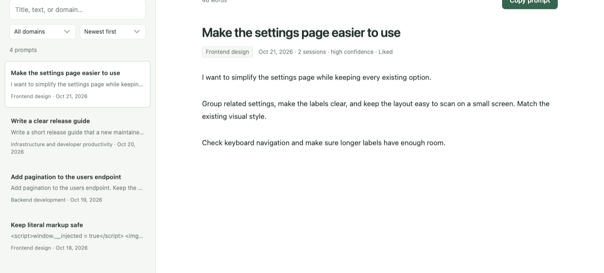
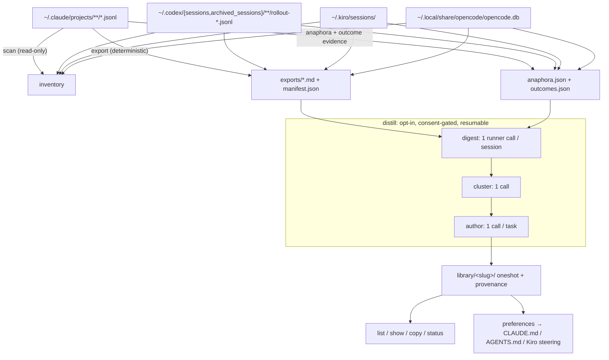

# Human Hindsight

> **The prompt you'd write if you knew then what you know now.**

[](https://www.npmjs.com/package/human-hindsight)
[](https://github.com/adityaarunsinghal/human-hindsight/actions/workflows/ci.yml)
[](https://nodejs.org)
[](LICENSE)
[](#privacy--trust)

<p align="center">
  
</p>

```bash
npx human-hindsight@latest
```

Human Hindsight mines your coding-agent session history (Claude Code, Codex, Kiro, OpenCode)
into two things you can use tomorrow morning:

1. **A oneshot prompt library.** For each real task you've done, the realistic
   ideal *first* prompt: everything you knew and wanted at t=0 but didn't say,
   written in your own voice.
2. **A distilled preference set.** The things you keep re-telling your agent
   ("diagnose before acting", "pin the versions", "be terse"), surfaced as a
   paste-ready `CLAUDE.md` or `AGENTS.md` block so every future session starts aligned.

Previously published as **cc-hindsight**. The `cc-hindsight` npm package is now a
deprecated compatibility command that forwards to the matching Human Hindsight
release. Existing libraries, edits, ratings, and checkpoints remain usable.

### Upgrading from cc-hindsight

```bash
npx human-hindsight@latest gui
# Or install the new command globally:
npm install -g human-hindsight
```

No data move or re-distillation is required. Data-directory precedence is:
`--home` → `HUMAN_HINDSIGHT_HOME` → legacy `CC_HINDSIGHT_HOME` → an existing
`~/.human-hindsight` → an existing `~/.cc-hindsight` → `~/.human-hindsight` for
a fresh installation. If both directories exist, the new one wins; use
`--home` to choose explicitly. Directories are never merged automatically.

In 1.8.2, existing preferences remain visible as **candidates**. Open the
Preferences tab, check the evidence and scope, then **Accept**, **Edit**, or
**Dismiss** each candidate. **Accepted instructions** builds a block from
accepted global rules, with an optional project selection. Task-only choices
stay out of standing instruction files. Reviews are saved in your library and
survive browser restarts.

Re-running `distill` refreshes results whose source content, prompt version,
runner/model selection, or grouping mode changed. Older checkpoints are refreshed
once because they have no input fingerprints. Hand-edited prompts are preserved;
`--force` explicitly allows replacing them.

Updating the old npm package installs the small compatibility wrapper, so
`npx cc-hindsight@latest gui` also works. Both global commands can coexist:
the main package owns `human-hindsight`, and the wrapper owns `cc-hindsight`.
The GitHub repository was renamed in place; old repository links redirect.

## The t=0 problem

You get better results the more context you front-load into your first prompt,
yet we underspecify at t=0 and spend the session steering: correcting course,
restating preferences, answering questions the agent shouldn't have had to ask.

And the cost repeats every session. Your working preferences are stable facts
about how you like to work, yet you re-derive and re-type them project after
project instead of stating them once, upfront, where every future session reads
them from the first message.

All the evidence of what you *should* have said is already on disk. Claude Code
saves session JSONL under `~/.claude/projects/`; Codex keeps rollouts under
`~/.codex/sessions/` and `~/.codex/archived_sessions/`; kiro-cli keeps its
own store under `~/.kiro/sessions` (both the flat `cli/<uuid>.jsonl` layout and
the newer per-session `<hash>/sess_<uuid>/messages.jsonl` layout). OpenCode keeps
its SQLite history under `~/.local/share/opencode/`. Plenty of
tools read that data for
dashboards and transcripts. **Nobody closes the loop from history back to
better prompting.**

**Before** (what you actually typed at t=0):

> help me script blocking a device on my home router

**After** (what human-hindsight distilled from how that session actually went):

> I want to automate my home router, starting with blocking a device. Get API
> access working first, and store any credentials securely instead of asking me
> to paste them in the clear. Anything that changes the network should be safe
> by default: show me what it'll do and let me confirm before it runs. Then
> prove it end-to-end on a real device. Research how others have done this
> first, and keep the setup written down so I can reproduce it.

The second prompt was knowable at t=0. You just hadn't written it yet.

## Quickstart

Start the guided terminal workflow:

```bash
npx human-hindsight@latest
```

After scanning, the CLI suggests **export** and asks whether to run it.
Type `y` to continue. Export offers **distill**, and a successful distillation
offers the browser library. Your library directory, source, project filter,
runner, and model stay selected through the handoffs.

Distillation still shows its model-call plan and asks for spending consent.
Follow-up offers default to No and appear only in an interactive terminal.
Use `--no-follow-up` for one command at a time; pipes, dry runs, and scripted
`--yes` invocations never start these follow-up commands automatically.

You can also start directly with distillation:

```bash
npx human-hindsight@latest distill    # offers to export first, then digest → cluster →
                            # author (asks before any runner call), then shows
                            # offers the finished library in your browser
```

Prefer to drive each stage yourself? The pipeline is just three verbs:

```bash
npx human-hindsight@latest            # 1. scan: inventory your projects (read-only)
npx human-hindsight@latest export     # 2. export: human-only markdown per session
npx human-hindsight@latest distill    # 3. distill: digest → cluster → author (asks first)
```

Then browse and curate the results:

```bash
npx human-hindsight@latest list                # your library (✎ edited / ▲▼ rating badges)
npx human-hindsight@latest gui                 # browse, search, and copy in your browser
npx human-hindsight@latest show <slug>         # read a oneshot
npx human-hindsight@latest copy <slug>         # → clipboard, paste into a fresh session
npx human-hindsight@latest edit <slug>         # open in $EDITOR; your edits are protected
npx human-hindsight@latest rate <slug> up      # record a verdict (up|down)
npx human-hindsight@latest prune               # remove orphaned entries (asks first)
npx human-hindsight@latest preferences         # accepted global rules → CLAUDE.md
npx human-hindsight@latest preferences --project my-app # include this project's accepted rules
npx human-hindsight@latest status              # pipeline funnel + orphan/skip flags
npx human-hindsight@latest retention           # optional: preview longer local retention
```

Requires Node 22.13+ on Node 22, or Node 23.4+ on newer releases, on macOS or Linux (Windows is untested and currently
unsupported). `scan` and `export` are fully deterministic: no LLM, no
network. `distill` uses your installed `claude`, `codex`, `kiro-cli`, or `opencode`,
with a consent prompt (or your explicit `--yes`).

### A small local library viewer

```bash
npx human-hindsight@latest gui                    # start locally and open your browser
npx human-hindsight@latest gui --no-open          # print the address without opening it
npx human-hindsight@latest gui --port 3210        # choose a port (default: any available port)
npx human-hindsight@latest gui --home /path/to/library-home
```

Switch between **Prompts** and **Preferences** to search, filter by domain,
sort, and copy items with one click. Preferences are deduplicated across tasks
and can be sorted by frequency, recency, or text. Search also matches their
evidence and source prompt titles.
One expandable domain tree lets you browse from broad categories down to
five levels. Select a parent to include its descendants, or expand its arrow
to choose a child. Prompt details show shared ancestry once; open **+N** to
see the full grouped hierarchy. Domain labels from the same evidence are
deduplicated regardless of casing.
Existing flat labels are grouped locally without changing the library or
making a model call; newly distilled sessions use hierarchical domain paths.
**Preview** renders Markdown headings, lists, tables, links, blockquotes, task
lists, and code blocks. **Markdown** shows the original source. Copy always
uses that original Markdown, including when the preview is selected.

Each prompt links to its preference candidates. Newly distilled candidates
show exact human quotations, message references, and global/project/task scope;
older observations are labeled for review. Open the collapsed **Source evidence**
section to see quotations. Use the check, pencil, and dismiss icons to review
a candidate; each control has an accessible label and hover description.
Candidates can come from failed or unfinished sessions too. You can bookmark
either view and use your browser's Back and Forward buttons. **All** shows
observations; **Accepted** provides the reviewed instruction block for `CLAUDE.md`
or `AGENTS.md`. Changed source evidence returns a candidate to review.

The terminal `preferences` command also exports accepted rules by default.
Use `--include-unreviewed` explicitly to inspect draft observations in scripts.
This flag does not accept them or change their review status.

A compact tip card sits in the header and flips through quick suggestions.
Open it to read the explanation, copy a `npx human-hindsight@latest` command,
or pause or hide tips. The lightbulb restores hidden tips. Rotation pauses
while you interact, and reduced-motion settings disable the flip animation.
Hidden tips stay hidden when you reload the same local address.

Export and distill show an open-source/privacy reminder near the start.
Interactive terminals get a colorful elapsed-time progress indicator during
scanning, export, and model work; redirected output stays free of animation.

Consolidation is optional: `npx human-hindsight@latest preferences --consolidate`
uses your accepted rules in a call through your own coding harness and its configured provider,
with consent and the subscription/credit cost explained first. Successful
results are saved, with their Markdown and input metadata, in
`<home>/library/preferences.consolidated.json`. Reload the browser and select
**Saved** to open the consolidation. Every output rule links to its input preferences.
Coverage, scope, explicit conditions, and direct contradictions are checked;
invalid output gets one semantic correction attempt. Failed, empty, incomplete,
or declined results leave the last saved result intact. Saved results are
flagged when the selected inputs or their review status change. Legacy saved
results remain readable and need regeneration before copying as reviewed
instructions.

The viewer uses a minimal black-and-white palette and system monospace fonts.
Light and dark appearance follow your system setting. Rows emphasize titles;
session counts remain visible, and the information icon reveals dates,
confidence, local edits, and ratings. Reload the browser after changing files
and press `/` to focus search.

The GUI uses Node's built-in HTTP server and bundled HTML/CSS/JavaScript:
no frontend framework, database, font download, or external assets.
Markdown parsing and sanitization ship inside the bundle. Raw HTML stays
inert and remote images are represented by their alt text, without fetching them.
It listens only on `127.0.0.1` and stops with Ctrl+C. Browsing stays read-only.
The single write action saves an explicit preference review to
`library/preferences.review.json`; it requires the current browser session's
token, matching origin, and a current candidate revision. The GUI never invokes
an agent, edits source history, or writes an instruction file for you.

### Multiple backends (Claude Code + Codex + Kiro + OpenCode)

Every command takes `--source claude|codex|kiro|opencode|auto` (default `auto`: read
whichever stores exist). Select the source after the subcommand. Directory
flags work before or after it:

| Source | Directory flag | Environment variable | Default |
|---|---|---|---|
| Claude Code | `--claude-dir` | `CLAUDE_CONFIG_DIR` | `~/.claude` |
| Codex | `--codex-dir` | `CODEX_HOME` | `~/.codex` |
| kiro-cli | `--kiro-dir` | `KIRO_CONFIG_DIR` | `~/.kiro` |
| OpenCode | `--opencode-dir` | `HUMAN_HINDSIGHT_OPENCODE_DIR`, then `XDG_DATA_HOME` | `~/.local/share/opencode` |

For OpenCode, `--opencode-db` selects a database explicitly; relative names
resolve under the data directory. It overrides `HUMAN_HINDSIGHT_OPENCODE_DB`
and OpenCode's `OPENCODE_DB`, with `opencode.db` as the default. An in-memory
database has no persisted history to read. Configuration is separate:
`OPENCODE_CONFIG_DIR` or the XDG config directory, normally `~/.config/opencode`.
Human Hindsight's directory/database flags select source history; the OpenCode
runner uses the CLI's normal data location and authentication.

Multiple stores merge into one library; the manifest tags each session's
`origin` and the export summary breaks the count down. Codex discovery includes
active and archived rollouts from the CLI, IDE extension, and app, grouped by
their working directory. Mirrored user/assistant events are paired, injected
context and subagent sessions are excluded, and human decisions and images
survive extraction. The kiro backend
reads both on-disk store layouts (the flat v2 store and the newer v3 per-session
store), preferring the v3 copy when a session was migrated into both.

`distill --runner claude|codex|kiro|opencode|auto` chooses which CLI does the distilling,
independently of `--source`. `auto` prefers the CLI matching an explicit source,
then falls back in the order Claude → Codex → Kiro → OpenCode. Models are passed through
with `--model`; without it, the chosen CLI uses its configured default.

```bash
npx human-hindsight@latest export --source codex
npx human-hindsight@latest distill --source codex --runner codex
npx human-hindsight@latest distill --source claude --runner codex
npx human-hindsight@latest preferences --target codex  # AGENTS.md; alias of --target agents
npx human-hindsight@latest export --source opencode
npx human-hindsight@latest distill --source opencode --runner opencode
npx human-hindsight@latest distill --source claude --runner opencode --model provider/model
npx human-hindsight@latest preferences --target opencode  # AGENTS.md
```

`preferences --target claude|codex|kiro|opencode|agents` emits a `CLAUDE.md` block,
an `AGENTS.md` section, or a block for `~/.kiro/steering/`. An explicit Codex
source defaults to `AGENTS.md`. The Codex runner uses `codex exec` with a JSON
schema, a read-only sandbox, and ephemeral sessions; generated distill sessions
do not become new source history. Claude supports current `structured_output`
results as well as legacy `result` objects/strings and verbose event arrays.
The Claude runner requires current isolation controls, including `--safe-mode`.
It runs from a private directory, disables tools, hooks, skills, and ambient
MCP configuration, supplies a dedicated system instruction, and disables session
persistence. Unsupported CLIs fail before any model call with an upgrade hint
or the option to choose another runner. Updating Human Hindsight does not update
Claude Code. Organization-managed policy remains authoritative; these controls
do not override administrator policy or constitute an operating-system sandbox.

### OpenCode 1 and 2

OpenCode support covers both current release families: `opencode-ai` 1.19
(verified with 1.19.4) and `@opencode/cli` 2.1 (verified with 2.1.3).
Both install an `opencode` command. Source discovery does not need the CLI.

The reader handles OpenCode 1's session/message/part SQLite tables, OpenCode 2's
ordered message records, and recognized older `storage/session`, `storage/message`,
and `storage/part` JSON directories. It includes archived sessions, preserves
question answers and attachment markers, and excludes generated subagent and
distillation sessions. Completed compaction resets short-reply context;
explicit execution failures are included in the outcome evidence.

Read-only SQLite connections include committed WAL data. Human Hindsight never
migrates the source database. An unreadable, busy, unsupported, or incompletely
migrated OpenCode database stops export before replacing the manifest or pruning
existing exports. If migrated copies coexist, matching human turns are deduplicated;
divergent older copies keep distinct export names. Reverted tails are excluded.
Only committed conversation messages are read, not pending inbox items.

The OpenCode runner uses JSON events, validates the final answer, and permits one
corrective retry. It copies provider/model settings from JSON or JSONC into an
owner-only temporary configuration, while OpenCode continues to handle credentials.
Project instructions, external agent plugins, and MCP configuration are not copied.
A dedicated agent denies tools; OpenCode 2 uses an owned private server.
Providers that require external agent plugins may need a built-in or compatible
provider configuration for this runner.

Generated sessions are marked and excluded from future exports. After the run,
cleanup deletes only captured IDs whose title and working directory prove they
belong to that run. Interrupted runs or cleanup failures can leave marked sessions
behind. User settings and unrelated sessions are preserved.

OpenCode preferences can go into the project's `AGENTS.md`, or the global
`AGENTS.md` under your OpenCode config directory.

### Optional: keep more local history

```bash
npx human-hindsight@latest retention                    # read-only preview
npx human-hindsight@latest retention --apply            # preview, then confirm
npx human-hindsight@latest retention --apply --yes      # explicit opt-in for scripting
npx human-hindsight@latest retention --source codex --apply
```

The default reviews existing tool directories. An explicit `--source` can
create that tool's settings file. `--yes` alone never applies changes, and
`--dry-run` always keeps the command read-only.

- **Claude Code:** raises `cleanupPeriodDays` to 365,000 days (about 1,000
  years), preserving an already longer value. Claude requires a positive whole
  number; `0` is invalid. If desktop cleanup is capped, sets
  `desktopSessionCleanupPeriodDays` to `0`, its supported no-age-limit value.
  An absent desktop setting already has no age limit.
- **Codex:** sets `[history] persistence = "save-all"` and removes
  `history.max_bytes`, leaving prompt history uncapped. This controls
  `history.jsonl`; full session rollouts are stored separately. Avoid
  `--ephemeral` for your own sessions you want to retain.
- **kiro-cli:** explains automatic persistence and `/chat save <path>` for
  additional copies. Its public settings reference does not document a
  retention-limit switch, so no configuration key is invented.
- **OpenCode:** reports the local data/config locations and archival guidance.
  No supported full-session age/size retention setting is documented. OpenCode 2
  keeps earlier messages after compaction and ignores the older `compaction.prune`
  setting. Temporary overflow tool-output files have separate cleanup (seven days
  in 2.1); output-size limits do not change that lifetime. This integration is
  advisory and leaves compaction settings untouched. For an extra copy, use
  `opencode session export <id>` on OpenCode 2 or `opencode export <id>` on OpenCode 1.

Applying creates owner-only backups next to existing configuration files, then
replaces each file atomically. Other settings are preserved; common Codex TOML
layouts retain comments, while unusual layouts may be reformatted after a
preview notice. Malformed configurations are left untouched.

Longer retention keeps prompt contents on disk longer and can use more space.
Restart running tools after applying settings. Project settings, profiles,
managed policy, and startup flags can override user defaults; this command
does not change those controls, remote retention, or telemetry. It cannot
recover already deleted history.

Setting references: [Claude retention](https://code.claude.com/docs/en/settings-reference#cleanupperioddays),
[Codex configuration](https://developers.openai.com/codex/config-reference),
and [Kiro conversation persistence](https://kiro.dev/docs/cli/chat/).
OpenCode references, pinned to the supported v2 release:
[compaction](https://github.com/anomalyco/opencode/blob/v2.1.3/services/www/src/docs/content/compaction.mdx),
[migration](https://github.com/anomalyco/opencode/blob/v2.1.3/services/www/src/docs/content/migrate-v1.mdx), and
[session commands](https://github.com/anomalyco/opencode/blob/v2.1.3/services/www/src/docs/content/cli/commands.mdx).

## Privacy & trust

For a tool that reads your entire conversation history, auditability is the
product:

- **Local-only.** Everything is read from your disk and written to your disk
  (`~/.human-hindsight`). No hosted service, accounts, or telemetry. The only network
  traffic is through your chosen agent CLI during consented distillation or
  preference consolidation.
- **One self-contained npm package.** JavaScript libraries are bundled into
  the CLI; the published package has no npm dependencies or installation
  scripts. SQLite comes from Node. Starting the app does not install compilers,
  platform bindings, or build tools. The development dependency tree is pinned
  in the repository's `package-lock.json`, which is not published. Bundled
  libraries include citty, Zod, Clack, smol-toml, jsonc-parser, Marked, and
  DOMPurify; their license texts ship in `dist/THIRD_PARTY_NOTICES.txt`.
- **Consent-gated LLM use.** `distill` states its estimated invocation count and
  waits for `[y/N]` before anything runs on your subscription/credits.
  `--dry-run` shows the full plan for free. If you decline, it exits without
  invoking anything (exit code 2).
- **Plain statement:** exports contain your raw prompts, including anything
  sensitive you ever pasted into a session (keys, internal names, that one
  angry message). They live in your home directory with your permissions, and
  nothing ships them anywhere. A `--redact` option is on the roadmap.

## How it works



The extraction layer is a fidelity contract: eleven audited rules decide what
counts as human input (attachments typed while the agent was busy, recovered
slash commands, `[decision]` lines from option picks, `[image pasted]`
markers), with a regression fixture per rule. Fork/resume duplicates are
deduped globally. Short replies like "yes" and "option 2" get their antecedent
attached so the author stage knows what you approved. Sessions carry an
outcome classification, so a task where nothing ever succeeded gets skipped
instead of becoming a confident prompt that reproduces a failure path.

Authored oneshots pass a **"knowable at t=0" test**: they front-load intent,
constraints, preferences, and quality bars, while leaving out facts you only
discovered mid-session (paths, root causes, error messages). And they respect
an **effort budget**, staying around the length a motivated human would
actually type rather than ballooning into a 700-word spec.

Every distill stage checkpoints to disk after each unit of work: Ctrl-C loses
nothing, re-running resumes, `--fresh` resets deliberately, and `status` flags
library entries orphaned by re-clustering.

## How it compares

| Tool | Reads `~/.claude` | Output | Direction |
|---|---|---|---|
| ccusage | ✓ | usage/cost tables | backward (metrics) |
| sniffly | ✓ | analytics dashboard | backward (behavior) |
| claude-code-transcripts | ✓ | shareable HTML transcripts | backward (record) |
| cctrace / exporters | ✓ | markdown/XML exports | backward (archive) |
| **human-hindsight** | ✓ | **oneshot prompt library + CLAUDE.md preferences** | **forward (better next session)** |

Closest kin is Simon Willison's `claude-code-transcripts`: same local-first
values, same belief that transcripts are undervalued artifacts. The difference
is the direction of gaze: it renders your sessions (backward, for others);
human-hindsight distills them (forward, for you).

## FAQ

**Does my data leave my machine?**
The deterministic commands (`scan`, `export`, and `retention`) never touch the
network. `distill` and `preferences --consolidate` send content through your
chosen local agent CLI to its configured provider, using its authentication.

**What does distill cost?**
Whatever your chosen agent CLI costs you: it runs on your existing subscription or
API credits. The consent prompt estimates the invocation count up front
(one call per session digested, one to cluster, one per task authored), and
`--dry-run` prints the same plan without running anything. Checkpoints mean an
interrupted run can reuse completed work. Retries and windowed grouping may add
calls. Sessions too large for the input budget
(default 400k chars, `--input-budget`) are **refused before anything is
spent**. Re-run with `--truncate=extreme` to cut them (recorded in
provenance) or narrow the scope. Digest and author calls run 3 at a time by
default (`--concurrency`; `1` = sequential).

**Subscription or API?**
human-hindsight shells out to `claude -p`, `codex exec`, `kiro-cli chat`, or `opencode run`;
however your chosen CLI is authenticated is how calls are billed. `--model`
passes through without pinning a model version.

**Why is a session missing from my exports?**
Sessions with zero human messages are skipped naturally, `--min-messages`
filters thin ones, and fork/resume copies are deduped into their original
session. Note that dedupe is global across all projects: with `--project`, a
message duplicated by fork/resume is attributed to its earliest session even
when that session is outside the filter. Run `export --verbose` to see every
dropped piece with a reason. If genuine human input was dropped, that's a
bug: file an extraction-fidelity report.

**Can I regenerate everything from scratch?**
`human-hindsight distill --fresh` clears the checkpoints (after confirming) and
re-runs. Old library entries from previous generations are flagged as orphans
in `status`.

## Roadmap

- Claude Code **plugin packaging** for existing marketplaces (for
  distribution, without standing up a separate marketplace)
- An in-session **skill variant** ("distill this session as we go")
- **Agent SDK** orchestration exploration
- **parentUuid-aware anaphora** (branch-correct antecedents on forked
  conversations)
- **`--redact` patterns** for exports
- An opt-in **community oneshot showcase**

## Development

```bash
npm install
npm test            # vitest: fixtures only, never reads your agent stores
npm run lint        # biome
npm run typecheck   # tsc --noEmit
npm run build       # tsdown → dist/
```

See [CONTRIBUTING.md](CONTRIBUTING.md), especially the guide to adding a
fixture when you hit an unhandled transcript shape.

## License

[MIT](LICENSE)

## Author

Built by [Aditya Singhal](https://adityasinghal.com). If human-hindsight surfaces
a pattern you didn't know you had, [I'd love to hear about
it](https://github.com/adityaarunsinghal/human-hindsight/issues).
