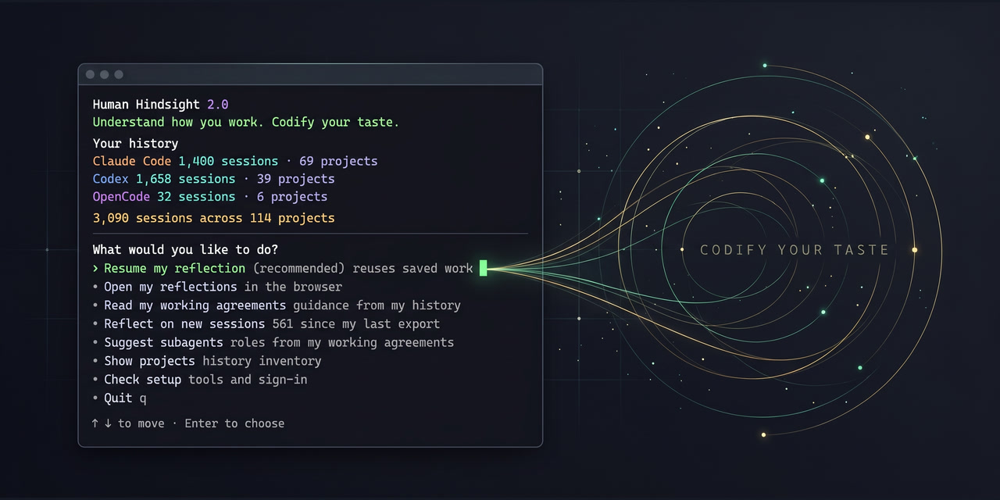

# Human Hindsight

<p align="center">
  
</p>

> We have used a lot of different technologies; over months and over years. Claude Code, Codex, Kiro CLI/Kiro Crew, OpenCode, Pi... the list goes on.
>
> You are the one piece of the puzzle that unites them all.
>
> This tool helps you to understand yourself better, and then to 'codify' your taste. Your taste, your nudges, and your corrections are what makes you and your AI's work different from them and their AI's work. Run `npx human-hindsight` from your machine to get the full overview.
>
> This tool is private and local except that it uses your own coding-agents to reflect, so your normal inference provider will receive messages, and will cost you tokens.
>
> If you spot problems then please [leave an issue](https://github.com/adityaarunsinghal/human-hindsight/issues) and PRs are welcome!

[](https://www.npmjs.com/package/human-hindsight)
[](https://github.com/adityaarunsinghal/human-hindsight/actions/workflows/ci.yml)
[](https://nodejs.org)
[](LICENSE)
[](#privacy--trust)

<p align="center">
  
  <br><sub>CLI walkthrough recorded before the rename to Human Hindsight.</sub>
</p>

Human Hindsight is a command-line tool. It reads the session history that Claude Code, Codex, Kiro CLI, Kiro Crew, and OpenCode keep on your machine and picks out the messages you typed. From those it builds a library of first prompts you can reuse, working agreements quoted from your own instructions and corrections, and optional suggested subagents. You browse all of it in a local web page.

```sh
npx human-hindsight
```

## What you see

**1. Your tools and your history.** The first screen lists the coding tools it found: the history on disk, whether the command is installed, and a sign-in hint. It appears at once and fills in as slower checks finish, without changing height: a version still being checked shows as the command name with an ellipsis (`✓ claude…`).

```text
│ Human Hindsight 2.0.0
│ The prompt you'd write if you knew then what you know now.
│
│ Your coding tools on this machine
│ Tool         History on disk          Command         Sign-in
│ Claude Code  2 projects · 4 sessions  ✓ claude 9.9.9  ✓ ready
│ Codex        1 project · 1 session    ! missing
│ No history or command found for Kiro CLI or OpenCode.
│ 5 sessions across 3 projects. Newest activity: today.
│
│ Private by default
│ No session text leaves this machine until you approve a plan.
│ This screen only asks your coding tools for their version and sign-in status.

What would you like to do?
› 1  Build my prompt library (recommended)  export, then a plan you approve
  2  Export my prompts only  Markdown, no model calls
  3  Show every project  the full inventory
  4  Check my setup  versions, sign-in, fixes
  q  Quit
  Use arrow keys and Enter, or press a number.
```

**2. The plan, before anything is sent.** Building the library first saves your messages as Markdown, locally, and says what it saved:

```text
Exported 5 sessions with 19 of your messages.
By tool: 4 Claude Code, 1 Codex.
```

When sessions are left out, one more line says how many and why, for example "3 sessions were left out: outside --project site." Then it shows a plan: the CLI that will run (and any other ready CLI that can take over if it stops working), how many calls, the models for each quality choice, and what is sent.

```text
  Distill plan

  Reads    5 sessions, about 2 prompts, plus your working preferences.
  Runs on  Claude Code (claude 9.9.9)
  Calls    5 session reads, about 1 grouping call, and about 2 writing calls.
           Then the working preference summaries. Their count is known after
           reading sessions.
           Up to 10 at a time. Grouping runs one call at a time.
  Models   1 Balanced (selected): sonnet for session reads, opus for grouping
           and writing
           2 Best: opus for session reads, fable for grouping and writing
  Sending  The selected session text and your working preferences go to your
           provider through Claude Code, the same way your normal sessions do,
           and the calls use your tokens there. Before the first model call, two
           tiny requests, one for each model, check that Claude Code is ready;
           when everything is reused, nothing is sent.

Start?
  1  Balanced (selected)
  2  Best
  s  Start with Balanced
  q  Not now
```

Press `s` to start, or `q` to decline; nothing is sent until you start. `1` and `2` only choose between Balanced and Best. This is the one question Enter does not answer: Enter, a number, pasted text, and a key held down from an earlier menu never start a run, and the question answers "Press s to start, or q to leave." Keys typed before any question appears never answer it either: the question says "Ignored keys typed ahead. Choose when you are ready." and waits. With more than 25 eligible sessions it first asks whether to begin with your 25 most recent sessions or with everything. Work from a shorter first run is reused when you do the rest.

**3. The run.** Just before the first model call, it sends one tiny request for each model the plan will call, and names the models that answered. Each stage then shows a progress line with items done, failures, elapsed time, and an estimate, and ends with one summary line.

```text
Checking that Claude Code is ready.
Claude Code is ready: sonnet reads sessions, opus groups and writes.

Read 5 of 5 sessions.
Grouped 5 sessions into 3 prompts.
Library: 2 prompts written, 1 group skipped because every session in it was abandoned.
A prompt is not written for work that was abandoned. Preferences from those
sessions are still kept.
1 prompt is marked outcome not verified: none of its sessions was seen to reach
a result.
Working preferences: 1 preference summarized into 1 working agreement.
```

The session reads also judge how each session ended. A closing report of finished work that you did not dispute counts as completed. Open items, a pause, or a correction that went unanswered count as partial. Giving up, or an ending that says the work could not be done, counts as abandoned. Unclear is kept for sessions with no ending to judge. A group with at least one completed or partial session gets a prompt. A group whose every session was abandoned gets none, and its preferences are still kept. Any other group gets a prompt marked "outcome not verified": in the prompt file's header, in `list`, `show`, and `status`, and in the browser view, which never suggests such a prompt first while a verified one is available. `--verbose` names each skipped group and why.

The closing summary lists the calls each CLI made, then offers what to do next:

```text
What next?
› 1  Open my library (recommended)
  2  Generate my subagents  specialist roles built from your working agreements
  3  Done for now
  q  Quit
```

Ctrl-C stops the calls in flight and ends their processes, keeps what finished, and prints the command that continues. An answer that arrives after Ctrl-C is discarded, and nothing is printed, written, or copied after this line:

```text
Interrupted. Sessions read so far are saved; the rest are read next time. To
continue, run:
  human-hindsight distill --quality=balanced
```

A command printed for you to run next keeps the choices of the run, and names a folder only when it is not the one you use by default.

**4. Your library in the browser.** `gui` opens a local page with three tabs: Prompts, Preferences, and Subagents. Each opens on an overview that suggests what to open first and why. Copy a prompt into a new session, or open a working agreement to see the quotations behind it.

## Privacy & trust

- **Stays on this machine:** scanning, exporting, the browser view, and every file Human Hindsight writes. Exports and results live in the data home (`~/.human-hindsight` by default), in folders and files only your user account can read.
- **Is sent, and when:** session text is sent only after you press `s` at the plan's Start question, or pass `--yes`. The approved CLI receives the selected session text, or for subagents your working preferences and their quotations, and passes it to the model provider that CLI already uses, with its own sign-in. The calls use your tokens with that provider. The plan names every CLI that may receive text.
- **Before approval:** Human Hindsight sends nothing and opens no network connection of its own. The first screen and `doctor` only run your coding tools' own version and sign-in status commands; what those commands do is up to each tool (Kiro CLI's sign-in status, for one, can contact its service). Building a plan may ask a CLI which models it offers, which can contact that CLI's service, and the screen says so before it happens. No session text is sent then.
- **Never:** Human Hindsight has no account, hosted service, or telemetry.

Your history can contain anything you once pasted into a session. Read exports before you share them. Details: [Security and privacy](SECURITY.md).

## Supported tools

| Tool | Read as history | Runs model steps | History location | Point elsewhere with |
| --- | --- | --- | --- | --- |
| Claude Code | yes | yes (`claude`) | `~/.claude` | `--claude-dir` or `CLAUDE_CONFIG_DIR` |
| Codex | yes | yes (`codex`) | `~/.codex` | `--codex-dir` or `CODEX_HOME` |
| Kiro CLI | yes | yes (`kiro-cli`) | `~/.kiro` | `--kiro-dir` or `KIRO_CONFIG_DIR` |
| Kiro Crew | yes | through `kiro-cli` | `~/.kiro/crew` | `--kirocrew-dir` or `HUMAN_HINDSIGHT_KIROCREW_DIR` |
| OpenCode | yes | yes (`opencode`) | `~/.local/share/opencode`, or under `XDG_DATA_HOME` | `--opencode-dir` or `HUMAN_HINDSIGHT_OPENCODE_DIR` |

By default every store that holds history is read. `--source claude`, `codex`, `kiro`, `kirocrew`, or `opencode` reads just one. The CLI that runs the model steps does not have to be the tool that wrote the sessions: Claude Code history can be distilled through Codex, and the other way around.

`doctor` covers tools that are only partly set up. History from a desktop app or editor extension can be exported even when its command is not installed, and `doctor` gives the command to install it. A command that looks signed out gets the sign-in command. Sign-in status is only a hint: the readiness check after you approve the plan is what confirms access.

```text
│ Tool         History on disk          Command         Sign-in
│ Claude Code  2 projects · 4 sessions  ✓ claude 9.9.9  ! run claude auth login
│ Codex        1 project · 1 session    ! missing

Claude Code suggests signing in. Run:
  claude auth login
Codex has a local history store. To distill through codex, run:
  npm install -g @openai/codex && codex login
```

## Quality: Balanced or Best

One choice works on every supported CLI.

- **Balanced** (the default): a Sonnet or Terra model reads sessions; an Opus or Sol model groups them and writes the prompts.
- **Best**: an Opus or Sol model reads sessions; a Fable or Astra model groups and writes.

Choose with `1` or `2` at the Start question, or with `--quality best`. `HUMAN_HINDSIGHT_QUALITY` sets the default.

Models come from each CLI's own model list: the newest version in each family, from the same vendor and prefix as the CLI's default model. Claude Code has no list to read, so it receives family names such as `sonnet` and `opus`, and the CLI and its provider decide which model that means. That can be older than the newest model your provider offers. To choose exactly, pass `--model`, or set the model in Claude Code's own settings. `doctor` says so when Claude Code uses a cloud provider.

If the provider refuses a model, the run steps down and says so in one line:

```text
Claude Code cannot use opus here (your provider refused it). Using sonnet for grouping and writing.
```

If the CLI itself stops working (signed out, missing, out of quota, or failing repeatedly), the remaining work moves to a CLI the plan listed as ready, also in one line. The run summary repeats each step-down and switch.

```text
Claude Code failed twice in a row. Continuing with Codex.
```

To keep the whole run on one CLI, pin it with `--runner codex`, or name a model with `--model`, `--cluster-model`, or `--author-model`. The plan then says "This run stays on this CLI." `--model` takes a model name your CLI accepts.

Some CLIs take fewer calls at once, and the plan's pace line says so, for example "Up to 2 at a time (OpenCode's limit)."

## Working preferences and suggested subagents

**Working preferences** are the instructions you keep giving your agents, such as "keep changes small", each with the quotation it came from. Every `distill` run ends by summarizing them, 20 at a time, into working agreements. If some batches fail, the summarized part is saved and shown, and the next run finishes the rest.

In the Preferences tab, general working agreements come first, grouped by the kind of work where each was seen; project-specific agreements sit under their project, and one-time notes are folded away. One button copies the general agreements as Markdown. Accept, edit, or dismiss each preference there. Then print the accepted ones as a block for your instruction file:

```sh
npx human-hindsight preferences --target claude   # CLAUDE.md
npx human-hindsight preferences --target agents   # AGENTS.md (Codex, OpenCode)
npx human-hindsight preferences --target kiro     # Kiro steering, also read by Kiro Crew
```

Without `--target`, the format follows `--source`, and is CLAUDE.md when every source is read. The block goes to standard output and the notes to standard error, so `preferences > file.md` writes only the block. `status` and `preferences` give the same counts of preferences observed, waiting for review, and accepted.

**Suggested subagents** are specialist roles, each with its own instructions, built from your preferences: the accepted ones when you have any, otherwise every one you have not dismissed. Generating them has the same kind of plan and Start question, and ends with its own menu to open or export the roles; it never opens the browser by itself.

```sh
npx human-hindsight suggest-subagents --dry-run
npx human-hindsight suggest-subagents
npx human-hindsight suggest-subagents --export ./my-subagents --target codex
```

`--export` writes the saved roles as files, locally and with no model call, for `claude`, `codex`, `kiro`, `kirocrew`, `knowledge`, or `all` (the default). Read `HANDOFF.md` in the export folder before copying roles into a folder your tool loads automatically.

## Requirements

- Node.js 22.13 or newer in the 22 line, or 23.4 or newer.
- macOS, Linux, or Windows through WSL.
- To build a library: at least one of `claude`, `codex`, `kiro-cli`, or `opencode`, signed in. Exporting needs none of them.

On an older Node, the command stops before doing anything and says how to run it:

```text
Human Hindsight needs Node.js 22.13 or newer in the 22 line, or 23.4 or newer; you have 18.20.2.
Run it with Node.js 24 without changing your default Node:
  npx -y -p node@24 -p human-hindsight@latest human-hindsight
Or install Node.js 24 from https://nodejs.org/en/download, then run your command again.
```

When it finds a Node version manager such as mise or Homebrew, it also suggests a one-off command for it.

## Remote and headless machines

Over SSH, `gui` uses port 4317 and prints what to run on your laptop:

```text
This is an SSH session, so open the library on your laptop.
1. In a second terminal on your laptop, forward the port:
   ssh -N -L 127.0.0.1:4317:127.0.0.1:4317 -- you@devbox
   (Use your usual SSH destination instead if you connect through an alias or a jump host.)
2. Open this address on your laptop:
   http://127.0.0.1:4317/#token=...
Press Ctrl+C to stop.
```

Over SSH, `copy` asks your own terminal to set the clipboard and always prints the prompt as well, so you can select it by hand.

## Everyday commands

| Command | What it does |
| --- | --- |
| `npx human-hindsight` | Guided start: setup table, then build or open your library |
| `npx human-hindsight --dry-run` | Show your setup and the next step, and stop |
| `npx human-hindsight doctor` | Check history, installed commands, and sign-in, with one fix per problem |
| `npx human-hindsight scan` | List every project and session found |
| `npx human-hindsight export` | Save your messages as Markdown; no model |
| `npx human-hindsight distill --dry-run` | Show the plan and send nothing |
| `npx human-hindsight distill --recent 25` | Start with your 25 most recent sessions |
| `npx human-hindsight gui` | Open the library in your browser |
| `npx human-hindsight status` | See what has finished and what to run next |
| `npx human-hindsight list` / `show NAME` / `copy NAME` | Browse and copy prompts in the terminal |

`list` fits your terminal, keeps names whole, and notes prompts you edited or rated and those whose outcome was not verified (80 columns shown):

```text
Name              Title               Sessions  Written     Notes
----------------  ------------------  --------  ----------  --------------------
docs-cleanup      Tidy the project …  1         2026-11-24  outcome not verified
release-workflow  Improve the relea…  3         2026-11-24  ✎ edited, ▲ rated up

2 prompts
```

`help <command>` shows examples for one command, and `help --all` lists every command and option. A mistyped command or option is refused with the closest match. `--verbose` on `distill` and `suggest-subagents` shows detail per session, group, or role, and `status --verbose` shows internal bookkeeping.

Commands that change the library (`distill`, `export`, `prune`, `rate`, `edit`, `preferences --consolidate`, `suggest-subagents`, and a review in the browser) take turns. While one runs, another stops without changing anything, names the command that holds the library, and says what to remove if nothing is running:

```text
human-hindsight distill is changing this library (process 99618, started 2026-11-24T00:28:38.394Z). Nothing was changed. Run this again when it finishes. If no human-hindsight command is running, remove /Users/you/.human-hindsight/distill/writer.lock and run this again.
```

A run stopped with Ctrl-C keeps its turn until it has finished writing. A turn left behind by a command that is no longer running is taken back at once, or after a short wait when it was left under another machine name, as on a shared or synced data home.

Exit codes are the same everywhere: 0 done, 1 failed, 2 declined, 130 interrupted.

To keep the command installed: `npm install --global human-hindsight`.

## Upgrading from 1.x

Your existing data home keeps working, including a `~/.cc-hindsight` folder from before the rename. Results now record the model plan that produced them, so the first 2.0 `distill` regenerates earlier results once. The plan's Library row says how many, and what is kept:

```text
  Library  1 saved prompt. 4 earlier results will be regenerated. Hand-edited
           prompts, ratings, and reviews are kept.
```

If the new grouping no longer includes an earlier prompt, the run keeps it and says how to remove it:

```text
1 earlier prompt is no longer part of the grouping. It is kept; remove it with:
  human-hindsight prune
```

The browser view lists such prompts apart from current ones. A prompt you edited by hand is kept as you wrote it; `distill --force` replaces it from the saved result, with no new model call. Groups that 1.x skipped because no session showed a result now get a prompt marked "outcome not verified". Results written by 2.0 cannot be read by 1.x, so keep a copy of the data home if you might go back.

## Troubleshooting

- **Something is not detected, or a run cannot start:** run `npx human-hindsight doctor`. It prints the data home, each tool's status, and one command per problem.
- **The screen redraws badly, or you are recording:** add `--plain`, or set `HUMAN_HINDSIGHT_PLAIN=1`, for numbered prompts and static progress lines. With input or output redirected, the bare command prints the setup summary and a suggested next command instead of a menu.
- **No color:** set `NO_COLOR=1`. Terminals whose locale is not UTF-8 get plain ASCII symbols.
- **A different data home:** `--home DIR` or `HUMAN_HINDSIGHT_HOME`.
- **An option is refused:** nothing runs on a guess. A switch such as `--dry-run` takes no value other than `=true` or `=false`, and a stray word after it is an error, so `--yes no` never runs as yes. A wrong value for `--source`, `--runner`, or `--quality` (or their environment variables) is refused in one line that lists the accepted values; a wrong number or an empty folder is refused in one line that names the option and the value given, for example `--concurrency takes a whole number of calls at a time, 1 or more, not "0".` The command goes first: a leading `--` is an error.
- **A command fails unexpectedly:** it prints one line and exits with 1. Run it again with `HUMAN_HINDSIGHT_DEBUG=1` for the details.

`cc-hindsight` remains as a compatibility command for the matching version. For development, see [Contributing](CONTRIBUTING.md). Release history: [Changelog](CHANGELOG.md). License: [MIT](LICENSE).

Created by [Aditya Singhal](https://adityasinghal.com).
