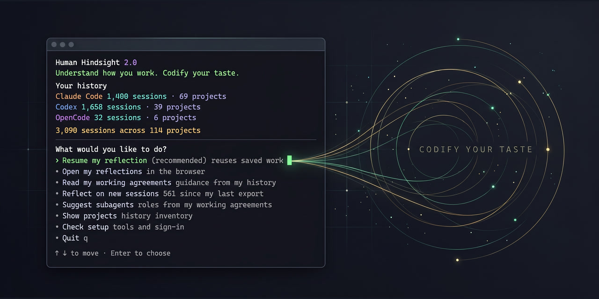

# cc-hindsight has moved to Human Hindsight

<p align="center">
  
</p>

**Understand how you work. Codify your taste.**

Start a new reflection with the current package.

```sh
npx human-hindsight
```

This deprecated package forwards the `cc-hindsight` command to the matching version of `human-hindsight`. The two commands use the same launcher and pass through arguments, input, output, signals and exit codes. They can be installed together. Both require Node.js 22.13 or later in the 22 line, or 23.4 or later.

Your existing `~/.cc-hindsight` library and `CC_HINDSIGHT_HOME` setting still work. New installations use `~/.human-hindsight` by default and accept `HUMAN_HINDSIGHT_HOME`. In 2.1 the command is called `reflect`. Scripts that use `distill` reach the same command. Upgrading from 2.0 keeps your hand-edited prompts, ratings and preference reviews.

[Main README](https://github.com/adityaarunsinghal/human-hindsight#readme) · [Release notes](https://github.com/adityaarunsinghal/human-hindsight/blob/main/CHANGELOG.md) · [Selected Work](https://adityasinghal.com/#current)
